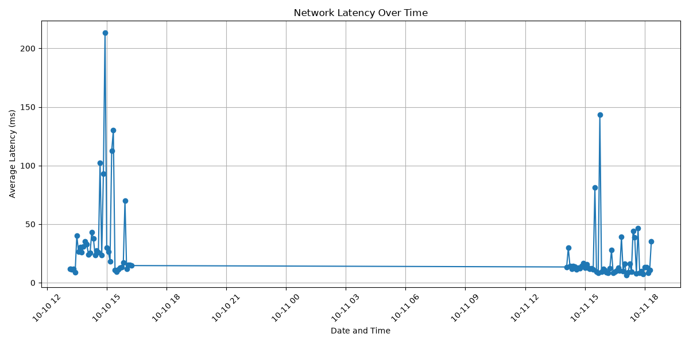
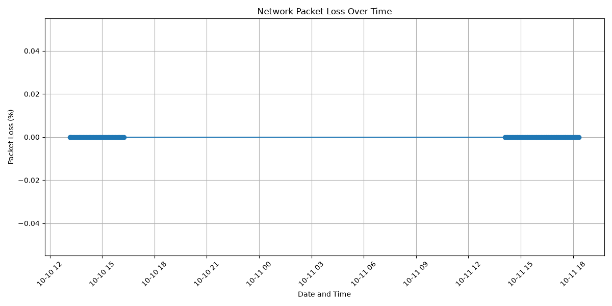

#
# Ubuntu Network Monitoring & Troubleshooting Lab

## Project Overview
Built an automated network monitoring system using Ubuntu Linux and Bash scripting to monitor connectivity, latency, packet loss, and DNS resolution.

## Technologies Used
- Ubuntu Linux
- Bash scripting
- Cron job scheduling
- Ping and Linux networking utilities
- DNS resolution with getent
- Linux log files

## Features
- Automated network checks every 5 minutes
- Internet connectivity monitoring
- Packet loss detection
- Average network latency measurement
- High latency alerts above 100 ms
- DNS resolution monitoring
- Timestamped monitoring and alert logs
- Automatic default gateway detection and connectivity monitoring
- Automatic Internet availability tracking every five minutes
- Uptime reporting with total checks, successful checks, failed checks, and availability percentage
- Automated daily network health reports with availability statistics
- Network fault diagnosis for gateway, internet, and DNS failures
- Linux time synchronization troubleshooting using Chrony and NTP

## Project Structure
- scripts/network-check.sh - Main monitoring script
- logs/network-check.log - Network monitoring history
- logs/alerts.log - Recorded network alerts
- documentation/network-baseline.txt - Initial network baseline

## Skills Demonstrated
- Linux command-line administration
- Network troubleshooting
- TCP/IP connectivitiy testing
- Bash scripting
- Task automation using cron
- Network performance monitoring
- Troubleshooting and debugging

## Future Improvements
- Monitoring dashboard
- Email notifications
- Historical performance reporting
- Additional network monitoring targets

## Troubleshooting Experience

During developement, I diagnosed and resolved several technical issues:

- Corrected Bash script logic that incorrectly reported packet loss.
- Fixed Linux file paths that prevented alert logs from being created.
- Troubleshot GitHub authentication failures using GitHub CLI.

These challenges strengthened my Linux troubleshooting, scripting, and problem-solving skills.

For detailed troubleshooting steps, see the [Troubleshooting Documentation](documentation/troubleshooting.md)

## Historical Network Performance Monitoring

The Ubuntu Network Monitoring Lab automatically collects network performance measurements every five minutes using Bash and cron.

### Performance Metrics
- Average network latency (ms)
- Maximum network latency (ms)
- Average packet loss (%)
- Timestamped historical measurements

### Scripts
- `scripts/network-check.sh` - Collects network measurements and records them in a CSV file.
- `scripts/performance-report.sh` - Analyzes historical data and calculates network performance statistics.

### Data Collection
Performance measurements are stored locally in `logs/performance.csv`.

Each record contains a timestamp, packet loss percentage, and average latency.

### Running the Performance Report

```bash
./scripts/performance-report.sh
```

This project demonstrates practical experience with Linux,
Bash scripting, cron automation, network troubleshooting,
CSV logging, and performance analysis.

## Python Network Monitoring Dashboard

This project includes a Python-based dashboard that visualizes historical network performance data collected by the Ubuntu monitoring system.

### Features

- Automated data collection every five minutes using Bash and cron
- Historical latency and packet-loss tracking
- Python data processing using CSV and datetime
- Network performance visualization using Matplotlib
- PNG graph generation for troubleshooting and reporting

### Network Latency Graph



### Network Packet Loss Graph



### Generate the Dashboard

Install Matplotlib in a Python virtual environment, then run:

```bash
.venv/bin/python dashboard/network-dashboard.py
```
The script reads `logs/performance.csv` and generates both graphs in the `dashboard/` directory.

**Note:** Historical performance logs are stored locally and are not uploaded to GitHub.

### Skills Demonstrated

Linux Administration | Python | Bash Scripting | Network Monitoring | Cron Automation | Data Visualization | Network Troubleshooting

## Automated Network Diagnostic Toolkit

Developed a Bash-based network diagnostic toolkit to automate common Linux network troubleshooting tasks.

### Features

- Automatically identifies the default gateway
- Tests local gateway connectivity
- Verifies external Internet connectivity
- Checks DNS resolution
- Displays the system routing table
- Traces network paths to external destinations
- Identifies listening TCP and UDP ports

### Run the Toolkit

```bash
bash scripts/network-diagnostics.sh
```

### Example Results

```text
PASS: Gateway 192.168.64.1 is reachable.
PASS: Internet connection is working.
PASS: DNS resolution is working.
```

### Technologies Used

- Ubuntu Linux
- Bash scripting
- TCP/IP networking
- ICMP and DNS
- iproute2, ping, nslookup, tracepath, ss

### Skills Demonstrated

Network Troubleshooting | Linux Administration | Bash Automation | DNS Diagnostics | Routing | TCP/IP | Network Security

## Automated Network Service Monitor

Built a Bash-based monitoring tool to check TCP service availability and automatically record failures.

### Features

- Monitors SSH connectivity on TCP port 22
- Uses Netcat (`nc`) to test service availability
- Records timestamped PASS and FAIL results
- Maintains a separate log for service failures
- Runs automatically every five minutes using Cron
- Supports monitoring additional TCP services

### Run the Monitor

```bash
bash scripts/service-monitor.sh
```

### Example Output

```text
Checking SSH on port 22. . .
PASS: SSH is reachable.
```

### Logging and Alerts

The monitor maintains two local log files:

- `logs/service-monitor.log` - Service check history
- `logs/service-alerts.log` - Detected service failures

Generated logs are kept locally and are not uploaded to GitHub.

### Automation

Configured Cron to execute the monitor every five minutes.

### Skills Demonstrated

Linux Administration | Bash Scripting | TCP/IP | Service Monitoring | Cron Automation | Network Troubleshooting | Log Management

## SSH Security Monitoring

Built an automated SSH security monitoring system using Bash and Ubuntu Linux.

### Features
- Detects failed SSH login attempts within a five-minute window.
- Identifies source IP addresses associated with failed logins.
- Triggers security warnings when three or more failures occur.
- Saves timestamped security alerts to a log file.
- Runs automatically every five minutes using cron.

## System Health Monitor

A Bash-based Linux monitoring tool that tracks CPU, memory, and disk usage in real time.

### Features
- Monitors CPU, memory, and disk usage.
- Uses Linux /proc/stat to calculate CPU utilization.
- Displays warnings when resource usage exceeds defined thresholds.

### How to Run

```bash
./scripts/system-health-monitor.sh
```

### Automated Monitoring

The System Health Monitor runs automatically every 5 minutes using Linux cron. Each execution records CPU, memory, and disk usage in system-health.log.

### Alert Logging

The System Health Monitor automatically records timestamped alerts in system-alerts.log when CPU usage reaches 80%, memory usage reaches 80%, or disk usage reaches 85%.

