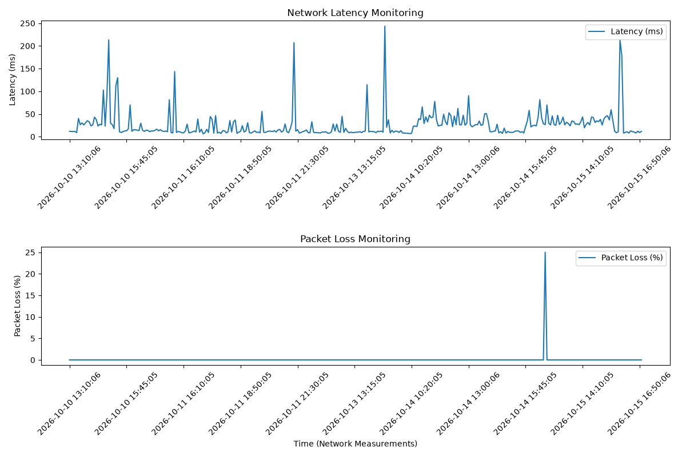
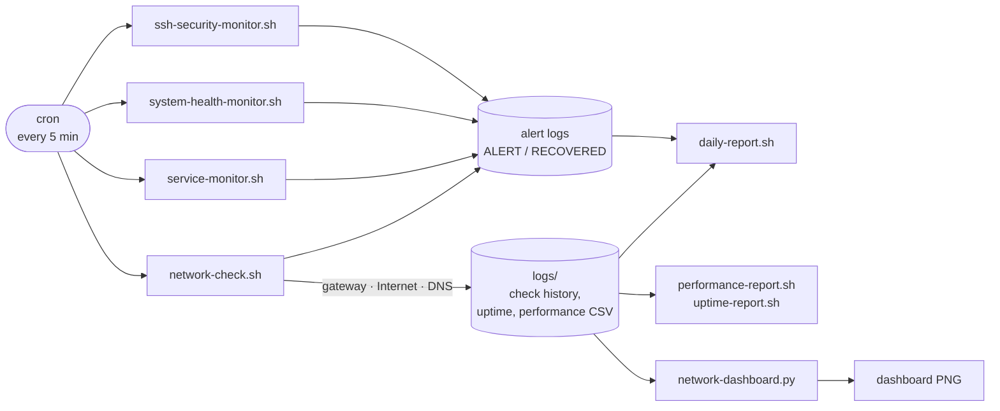

# Ubuntu Network Monitoring & Troubleshooting Lab

[](https://github.com/ares12god/ubuntu-network-monitoring-lab/actions/workflows/lint.yml)

A self-built monitoring system for an Ubuntu Linux server. Bash scripts scheduled with cron check the network every five minutes, diagnose where a failure is (local gateway, Internet, or DNS), raise and clear alerts, watch SSH logins and system resources, and produce daily reports and a Python dashboard.

I built it in a home lab to practice the day-to-day work of a network or systems administrator: monitoring, alerting, troubleshooting, and writing up incidents.



## Highlights

- **Fault isolation, not just up/down.** Each check tests the stack from the bottom up (gateway → Internet → DNS) and writes a diagnosis such as *"Gateway reachable but Internet unavailable"*.
- **Alerting without alert fatigue.** An alert is logged once when a problem starts and a `RECOVERED` entry is logged once when it clears, which gives exact incident start and end times.
- **A real incident, investigated.** On October 9 the monitor caught repeated gateway failures. I wrote up the timeline, evidence, and findings in an [incident report](reports/incident-2026-10-09.md).
- **Tested against failure, not only success.** Outages, packet loss, high latency, a gateway that drops ping, and DNS failures were all simulated to confirm each one is detected and diagnosed correctly ([troubleshooting log](documentation/troubleshooting.md)).
- **Security monitoring.** UFW firewall hardening, an SSH monitor that flags brute-force login attempts and the source IPs behind them, and a listening-port review that [found and disabled an unneeded service](documentation/firewall-security.md#finding-unintended-iperf3-service-october-21-2026).

## How it works



| Script | What it does | Runs |
|---|---|---|
| [`network-check.sh`](scripts/network-check.sh) | Pings the default gateway and an Internet host, measures packet loss and latency, resolves DNS, diagnoses the fault, and records uptime and performance history | cron, every 5 min |
| [`service-monitor.sh`](scripts/service-monitor.sh) | Confirms TCP services (SSH by default) accept connections, using `nc` | cron, every 5 min |
| [`system-health-monitor.sh`](scripts/system-health-monitor.sh) | Measures CPU (from `/proc/stat`), memory, and disk usage against thresholds | cron, every 5 min |
| [`ssh-security-monitor.sh`](scripts/ssh-security-monitor.sh) | Counts failed SSH logins in the last 5 minutes by source IP; alerts on 3 or more | cron, every 5 min |
| [`network-dashboard.py`](scripts/network-dashboard.py) | Charts latency and packet loss over time with Matplotlib, marking outages and the alert threshold | cron, every 5 min |
| [`daily-report.sh`](scripts/daily-report.sh) | Daily summary: availability, latency, packet loss, and alerts by type | cron, nightly |
| [`network-diagnostics.sh`](scripts/network-diagnostics.sh) | On-demand troubleshooting: gateway, Internet, DNS, routing table, path trace, listening ports | manually |
| [`performance-report.sh`](scripts/performance-report.sh) / [`uptime-report.sh`](scripts/uptime-report.sh) | Latency, packet-loss, and availability statistics over all history or one day | manually |

All settings (targets, thresholds, log locations) live in [`scripts/common.sh`](scripts/common.sh) and can be overridden with environment variables.

## Example output

A check during a period when the gateway stopped answering ping but the Internet stayed up, the same pattern seen in the October 9 incident:

```text
===========================================
Network Check: 2026-10-21 14:32:43
===========================================
Gateway Status: ALERT - 192.168.64.1 UNREACHABLE
Internet Packet Loss: 0%
Internet Average Latency: 12.345 ms
Internet Status: ONLINE
DNS Status: ONLINE
Diagnosis: GATEWAY NOT ANSWERING PING - Internet still reachable (gateway may be dropping ICMP)
Check completed.
```

The alert log for a simulated outage and recovery:

```text
2026-10-21 14:32:47 | ALERT | INTERNET CONNECTION OFFLINE (1.1.1.1)
2026-10-21 14:32:48 | RECOVERED | INTERNET CONNECTION RESTORED
```

## Lab environment

- Ubuntu Linux VM running in UTM on macOS
- NAT network `192.168.64.0/24`, gateway `192.168.64.1`
- Remote administration over SSH from the macOS host, protected by UFW ([firewall setup](documentation/firewall-security.md))
- Time kept accurate with Chrony/NTP, which matters for log correlation ([Issue 5](documentation/troubleshooting.md#issue-5-ubuntu-system-clock-synchronization-failure))

## Quick start

On Ubuntu:

```bash
git clone https://github.com/ares12god/ubuntu-network-monitoring-lab.git
cd ubuntu-network-monitoring-lab

./scripts/setup.sh                  # checks dependencies, prints the cron schedule
./scripts/network-check.sh          # run one check now
cat logs/network-check.log

./scripts/setup.sh --install-cron   # start monitoring every 5 minutes
```

Dependencies: `iproute2`, `iputils-ping`, `netcat-openbsd`, `dnsutils`, `iputils-tracepath`, and `python3-matplotlib`. `setup.sh` lists anything missing. The SSH monitor reads `/var/log/auth.log`, so add your user to the `adm` group (`sudo usermod -aG adm "$USER"`).

Reports:

```bash
./scripts/daily-report.sh               # today (or pass a date: 2026-10-09)
./scripts/performance-report.sh         # all history (or pass a date)
./scripts/uptime-report.sh
python3 scripts/network-dashboard.py --days 7
```

Logs are written to `logs/` and generated reports to `reports/generated/`. Both stay on the lab machine and are not committed.

## Testing failure scenarios

`192.0.2.1` is a reserved documentation address that never answers, so pointing the check at it simulates a full Internet outage without affecting the real logs:

```bash
INTERNET_TARGET=192.0.2.1 LOG_DIR=/tmp/lab-test ./scripts/network-check.sh
cat /tmp/lab-test/network-check.log /tmp/lab-test/alerts.log
```

The same approach works for other thresholds, for example `LATENCY_THRESHOLD_MS=1` to trigger a high-latency alert or `DNS_TEST_HOST=does-not-exist.invalid` for a DNS failure.

## Documentation

- [Incident report: gateway failures on October 9](reports/incident-2026-10-09.md)
- [Troubleshooting log](documentation/troubleshooting.md): problems found while building and running the lab, with cause, fix, and lesson
- [Firewall and SSH security](documentation/firewall-security.md)
- [Network baseline](documentation/network-baseline.txt)

## Repository layout

```text
scripts/          monitoring, reporting, and setup scripts
documentation/    setup notes, troubleshooting log, baseline, images
reports/          incident report and sample daily report
logs/             created at runtime (not committed)
```

## Skills demonstrated

Linux administration · Bash scripting · cron automation · TCP/IP troubleshooting (ICMP, DNS, routing) · network performance monitoring · alerting and log management · SSH and firewall security (UFW) · Python data visualization (Matplotlib) · incident investigation and documentation · Git and GitHub Actions

## Future improvements

- Email or chat notifications when an alert is raised or cleared
- Monitoring additional targets and services (multiple Internet hosts, HTTP checks)
- Root-causing the October 9 gateway failures from router and firewall logs
